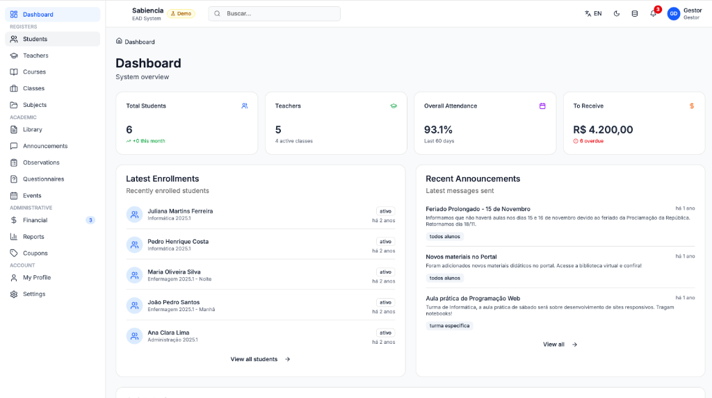
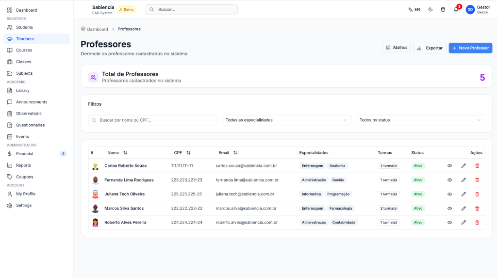
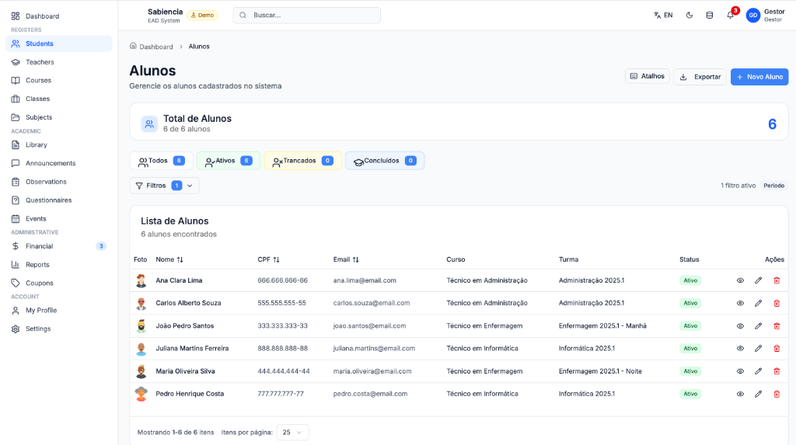

# Sabiencia — EAD Learning Management System


A modern, role-based learning management platform (LMS) for online education, built as a
single-page application with React, TypeScript and Vite. Sabiencia covers the full academic
workflow — students, teachers, classes, content, grades, attendance, announcements and
finance — with a tailored experience for each of its three user roles.

> **Internationalization:** the app is **English-first** with a one-click Portuguese toggle
> (persisted per browser). The entry surfaces (landing, demo, login) and the authenticated
> chrome (top bar, sidebar navigation) are translated; deeper page bodies are being migrated
> incrementally. See [ARCHITECTURE.md](docs/ARCHITECTURE.md).

---

## Table of contents

- [Highlights](#highlights)
- [Live demo](#live-demo)
- [Screenshots](#screenshots)
- [Roles & features](#roles--features)
- [Tech stack](#tech-stack)
- [Architecture](#architecture)
- [Engineering decisions](#engineering-decisions)
- [Getting started](#getting-started)
- [Environment variables](#environment-variables)
- [Available scripts](#available-scripts)
- [Project structure](#project-structure)
- [Performance](#performance)
- [Theming & accessibility](#theming--accessibility)
- [Testing](#testing)
- [Roadmap](#roadmap)
- [License](#license)

---

## Highlights

- **Three role-based experiences** — Manager/CEO, Teacher and Student, each with its own
  navigation, dashboards and permissions enforced by route guards (RBAC).
- **Runs 100% on realistic mock data out of the box** — no backend required to explore the
  product. With `VITE_APP_MODE=supabase` the academic journey (enrollment, grades, attendance)
  reads and writes a real Postgres database protected by tested RLS policies
  (see [Architecture](#architecture)).
- **Production-minded foundations** — protected routes, signed/expiring client sessions,
  lazy-loaded route bundles, global search (`Cmd/Ctrl + K`), data export (PDF/Excel/CSV),
  light/dark theming, and accessibility features (skip links, focus rings, reduced-motion
  and high-contrast support).
- **Typed end to end** with TypeScript, validated forms with React Hook Form + Zod, and a
  shadcn/ui + Tailwind CSS v4 component system.

## Live demo

The app ships with a **demo mode** that signs you in instantly with seeded data — no
credentials to type.

| Entry point | Path |
| --- | --- |
| Demo home (choose a role) | `/demo` |
| Student login screen | `/login/aluno` |
| Teacher login screen | `/login/professor` |
| CEO login screen | `/login/ceo` |

From the landing page, use **“Ver Demonstração”** (top bar) to open the role chooser `/demo`, or
**“Login”** to reach the login screen `/login/aluno`. On any of the login screens, the
**“Entrar como ...”** button authenticates the demo user with one click.

While demo mode is active, a discreet **Demo** badge is shown in the top bar.

## Screenshots

> The images below are placeholders. Capture the three dashboards from the
> [live demo](#live-demo) and replace the files in `docs/screenshots/` (keep the names).

| CEO dashboard | Teacher dashboard | Student dashboard |
| --- | --- | --- |
|  |  |  |

Light & dark themes and the EN/PT switch are available across the app.

## Roles & features

### Manager / CEO
Full administrative access: student & teacher management, courses, classes and subjects;
financial control with PDF report export; managerial reports; system audit; institution and
academic settings.

### Teacher
Pedagogical workspace: assigned classes and students, grade entry, attendance tracking,
teaching materials upload, lesson content, announcements and student observations.

### Student
Learning area: video lessons (YouTube), downloadable materials, grades, attendance history,
announcements, financial status, events and certificates.

## Tech stack

| Area | Technology |
| --- | --- |
| Framework | React 18 + TypeScript |
| Build tool | Vite 6 |
| Styling | Tailwind CSS v4, shadcn/ui (Radix UI primitives) |
| Routing | React Router v6 (lazy-loaded, role-guarded routes) |
| Forms & validation | React Hook Form + Zod |
| Internationalization | react-i18next (English-first, PT toggle) |
| Charts | Recharts |
| Data export | jsPDF, jspdf-autotable, SheetJS (xlsx) |
| Backend (optional) | Supabase (Auth, Postgres, Storage) |
| Testing | Vitest, Testing Library, Playwright (E2E + visual) |
| PWA | vite-plugin-pwa |

## Architecture

**Data layer: two explicit modes.** `VITE_APP_MODE` selects the source of truth
(`src/config/appMode.ts`); the modes never mix.

- `demo` (default) — a seeded dataset (`src/data/`) exposed through `MockDataContext`, persisted
  to `localStorage` (versioned) so changes survive reloads. No network calls, no secrets.
- `supabase` — Supabase Auth (`signInWithPassword`, CPF → e-mail via a `SECURITY DEFINER` RPC,
  profile looked up by `auth_id`). After login, `MockDataContext` loads what the user may see
  from Postgres (`src/services/academicRepository.ts`) and the journey writes —
  `cadastrarAluno`, `atualizarAluno`, `salvarNotas`, `salvarFrequencias` — go to the database
  first; the UI only reflects rows the database accepted. Demo fixtures are never shown in this
  mode.

**Database & RLS.** `supabase/migrations/` builds the schema (18 tables), seed, and RLS. Every
cross-table check goes through `SECURITY DEFINER` helpers (e.g. `professor_leciona`,
`aluno_matriculado_turma`), so policies never recurse. Managers see everything; teachers only
their classes/subjects and enrolled students, and can only write grades/attendance there;
students only their own records. Views run with `security_invoker`, and a trigger blocks
non-managers from changing `role`, `auth_id` or `ativo`. `supabase/tests/rls_test.sql` exercises
the full journey against real Postgres with allowed **and** denied cases (`npm run test:db`).

**Authentication & RBAC.** Login accepts CPF or e-mail. Sessions are persisted with a local integrity signature (HMAC) and a fixed expiry. Note that client-side HMAC signatures validate state consistency in local storage to prevent naive UI role tampering, while the true database security and API protection are handled through Supabase Row-Level Security (RLS) policies. `ProtectedRoute` enforces per-role access and redirects each role to its default dashboard.

**Routing.** Routes are split by role (`src/routes/`) and lazy-loaded so each area ships its
own bundle.

**Theming.** A custom `ThemeProvider` (`src/contexts/ThemeContext.tsx`) toggles light/dark/
system themes and font scale, persisted to `localStorage` and applied via a `.dark` class and
`data-font-size` attribute on `<html>`.

**Resilience.** An app-level `ErrorBoundary` catches render-time errors and shows a friendly
recovery screen instead of a blank page. Shared `EmptyState`, `LoadingSpinner`/`LoadingFallback`
and `ErrorDisplay` components standardize empty/loading/error UI.

## Engineering decisions

- **Mock-first, backend-ready.** Decoupling the UI from a specific backend lets reviewers run
  the app instantly while still demonstrating a production path (Supabase + RLS). Swapping the
  source is a layer change, not a rewrite.
- **English-first i18n.** The target audience is international; `react-i18next` defaults to
  English with a persisted PT toggle, rather than auto-detecting the browser locale, so the
  first impression is consistent.
- **Centralized RBAC.** Authorization rules live in one module (`utils/permissions.ts`) and are
  enforced at the routing layer, keeping permission logic testable and out of components.
- **Honest client-side security.** Client HMAC only guards local-state integrity; the real
  boundary is Supabase RLS. This is documented rather than implied (see PRD §13).
- **Lazy everything heavy.** Routes are code-split per role; `jsPDF` and `xlsx` load via dynamic
  `import()` so the initial bundle stays lean.
- **Pre-compiled stylesheet.** Tailwind ships pre-compiled (`src/index.css`); runtime additions
  (dark mode, font scaling) live in `src/styles/theme.css` imported afterwards.

## Getting started

### Prerequisites
- Node.js 20+ (developed on Node 22)
- npm

### Install & run
```bash
npm install
cp .env.example .env   # then fill in the values (see below)
npm run dev            # start the dev server (Vite)
```

The app runs at the URL printed by Vite (default `http://localhost:3000`). With
`VITE_DEMO_MODE=true`, you can use the demo entry points above without any backend.

### Production build
```bash
npm run build      # outputs to build/
npm run preview    # serve the production build locally
```

## Environment variables

Copy `.env.example` to `.env` and configure:

| Variable | Required | Description |
| --- | --- | --- |
| `VITE_APP_MODE` | optional | Application mode: `demo` (default, 100% offline, zero network requests) or `supabase` |
| `VITE_SUPABASE_URL` | for supabase mode | Supabase project URL |
| `VITE_SUPABASE_ANON_KEY` | for supabase mode | Supabase public anon key |
| `VITE_AUTH_SECRET` | for supabase mode | 32-byte hex secret used to sign client sessions (local integrity only). Demo mode uses a fixed public key |
| `VITE_DEMO_MODE` | optional | Legacy fallback: `true` enables demo mode (superseded by `VITE_APP_MODE`) |

> Only the public Supabase **anon** key is used on the client. Never commit `.env` — it is
> already git-ignored.

## Available scripts

| Script | Description |
| --- | --- |
| `npm run dev` | Start the development server |
| `npm run build` | Production build |
| `npm run preview` | Preview the production build |
| `npm run lint` | ESLint verification with zero warnings |
| `npm run type-check` | Static TypeScript type checking (`tsc --noEmit`) |
| `npm test` | Unit/integration tests (Vitest) |
| `npm run test:coverage` | Test coverage report with v8 engine |
| `npm run test:e2e` | End-to-end tests (Playwright) |
| `npm run test:db` | Apply all migrations to a throwaway Postgres and run the RLS tests |
| `npm run test:visual` | Visual regression tests |

## Project structure

```
src/
├── components/      # UI: ui/ (shadcn), layout/, shared/, and feature components
├── contexts/        # AuthContext, MockDataContext, ThemeContext, …
├── pages/           # Route pages grouped by role: gestor/, professor/, aluno/, demo/
├── routes/          # Lazy, role-guarded route definitions
├── data/            # Seeded mock dataset
├── hooks/           # Custom hooks
├── services/        # academicRepository: Supabase reads/writes for the academic journey
├── lib/             # Supabase client and low-level helpers
├── schemas/         # Zod schemas for forms/validation
├── utils/           # Formatters, export service, media thumbnails, permissions
├── styles/          # theme.css (dark mode & font scaling)
└── design-system/   # Brand & design tokens (see SABIENCIA_BRAND.md)
```

## Performance

- **Route-based code splitting:** each role area is lazy-loaded, so a user only downloads the
  screens they visit.
- **On-demand heavy libraries:** `jsPDF` and `xlsx` are imported dynamically (only when a user
  exports/imports), keeping them out of the initial bundle.
- **Vendor chunking:** React, Radix, Supabase, charts, PDF and spreadsheet code are emitted as
  separate cacheable chunks (see `npm run build` output).

## Theming & accessibility

- **Light / dark / system** themes plus a font-size scale, configurable in
  **Settings → Appearance** and via the theme toggle in the top bar.
- **Accessibility:** skip-to-content links, visible focus indicators, ARIA landmarks/labels,
  and respect for `prefers-reduced-motion` and `prefers-contrast`.

## Testing

Every suite below runs on CI (`.github/workflows/ci.yml`) on each push and pull request.

| Suite | Tool | Size | What it proves |
| --- | --- | --- | --- |
| Unit & integration | Vitest + Testing Library | 495 tests, 28 files | permissions, formatters, schemas, contexts (demo **and** supabase mode), forms, Supabase repository mapping |
| Database / RLS | Postgres 15 + `psql` | 42 assertions | migrations apply cleanly; gestor → professor → aluno journey with allowed and **denied** access per role |
| End-to-end | Playwright (Chromium on CI) | 39 tests, 5 specs | login per role, navigation, search/filter, and the cross-role journey: manager enrolls a student, teacher grades, student sees the grade after logout/login and reload |

Line coverage of the unit suite is about 21% — most page components are only exercised by E2E.

### Running tests locally

- `npm test` / `npm run test:coverage` — Vitest (coverage report in `coverage/`).
- `npm run test:e2e` — Playwright (starts the dev server automatically).
- `npm run test:db` — needs a disposable Postgres 15+ reachable through the standard `PG*`
  variables, e.g. `PGHOST=localhost PGUSER=postgres PGPASSWORD=postgres npm run test:db`.
  It drops and recreates the database named in `TEST_DB` (default `sabiencia_rls_test`).
- `npm run type-check` and `npm run lint`.

### Known limitations

- In `supabase` mode only the academic journey (courses, classes, subjects, students, teachers,
  enrollments, grades, attendance) is wired to the database. Library, announcements, payments
  and other modules stay empty in that mode instead of showing demo data.
- Creating a student in `supabase` mode creates the profile and enrollment; the login account
  (Supabase Auth user) must be created server-side and linked with
  `supabase/migrations/003_link_auth_ids.sql` (service role).
- The RLS tests run against plain Postgres with a minimal stub of Supabase's `auth` schema
  (`supabase/tests/00_supabase_auth_stub.sql`), not against a hosted Supabase project.

## Roadmap

- Extend i18n coverage to all deep page bodies (entry surfaces + app chrome already done).
- Storage-backed material uploads via Supabase Storage.
- Payment integration (invoices/receipts).

## License

Proprietary Non-Commercial License (see [LICENSE](LICENSE) file for full details).
